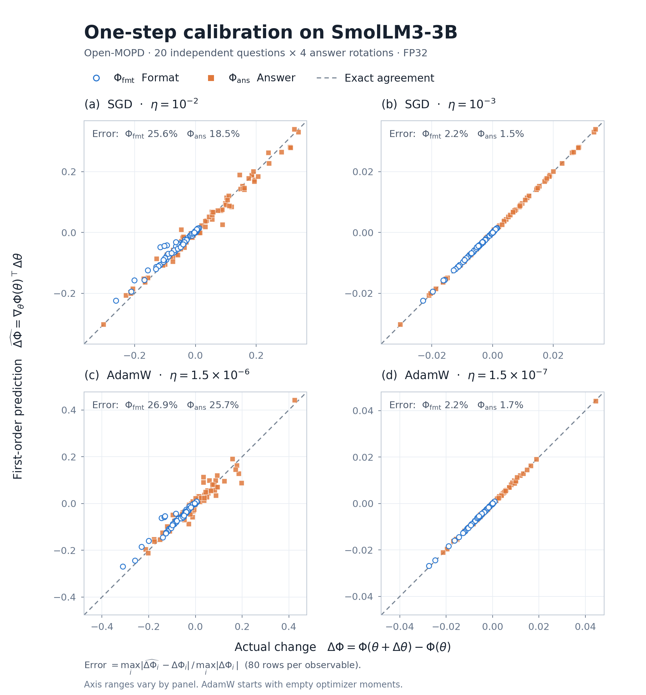

# StepScope

**See how model updates change behavior.**

[](https://github.com/Lexwzp0/stepscope/actions/workflows/tests.yml)
[](LICENSE)

Compare what an LLM update is predicted to change with what it actually changes.
Start from **two checkpoints** or **one optimizer step**; get an HTML report with
calibration plots, changes by domain, and source contributions for SGD.

[Quick start](#quick-start) · [Usage](docs/usage.md) · [Real 3B example](examples/real_case/README.md) · [Results](docs/validation.md)

## On a real model

One MOPD step on [SmolLM3-3B MixSFT](https://huggingface.co/BytedTsinghua-SIA/Open-MOPD-SmolLM3-3B-MixSFT),
measured on **20 MMLU-Redux questions × 4 answer rotations**. The two observables
track answer-format probability (Φ_fmt) and correct-versus-wrong preference (Φ_ans).

<picture>
  <source media="(prefers-color-scheme: dark)" srcset="docs/img/real_case_calibration_dark.png">
  
</picture>

At the smaller step sizes, first-order prediction reaches **≤ 2.2% normalized max
error** for both optimizers. At AdamW lr `1.5e-6`, it is 26–27%: step size matters.
Error here is `max|prediction − actual| / max|actual|`, across all 80 rows per
observable, not a per-item relative error bound.

This is a controlled single-step case with fresh optimizer state. The approximate
LDCL channels (CH1 + CH2) do not match exact first order on this model; their cause
of mismatch remains open. [Full results and limitations →](docs/validation.md)

## Quick start

Python 3.10+. After installation, the demo runs on CPU without model downloads.

```bash
git clone https://github.com/Lexwzp0/stepscope.git
cd stepscope
pip install torch --index-url https://download.pytorch.org/whl/cpu
pip install -e ".[torch]"
python examples/tiny_step_demo.py --out step_demo --objective mopd
```

Open `report_step.html` at the path printed by the demo. It builds a tiny random
model, takes one SGD step, and saves the report, result tables and update package.
Already have PyTorch installed? Skip the CPU PyTorch installation line.

## Use your own models

The current single-step path supports **SFT / Open-MOPD** with **SGD / AdamW** on
supported Hugging Face causal LMs. Validation covers tiny Llama and GPT-2 models
and the real SmolLM3-3B case above. AdamW source decomposition is not implemented.

| I want to… | Start here |
|---|---|
| Compare two checkpoints | [Checkpoint analysis](docs/usage.md#compare-your-own-checkpoints) |
| Inspect one optimizer step | [Single-step analysis](docs/usage.md#analyze-one-optimizer-step) |
| Reproduce the 3B result | [Inputs, hardware and commands](examples/real_case/README.md) |
| Understand the measurements | [Observables and output tables](docs/usage.md) · [Validation](docs/validation.md) |

Early research release. [Design, references and roadmap](docs/design.md) · [Citation](CITATION.cff) · [MIT license](LICENSE).
